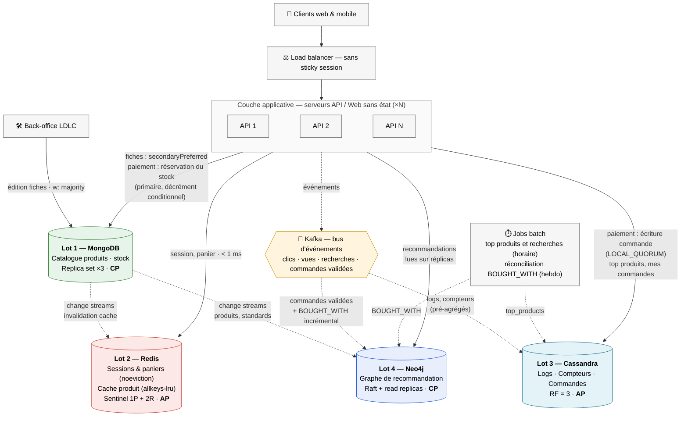

# Refonte LDLC : Architecture de données NoSQL

**Projet NSL NoSQL**

Binôme :
- Ariol **Kenfack**
- Raphael **Deutou**

## Description courte

LDLC (e-commerce high-tech : plus de 27 000 références, plus de 600 marques, jusqu'à 25 000 colis par jour) remplace sa base relationnelle monolithique par une architecture **NoSQL polyglotte**. Chaque besoin métier est confié à la technologie la mieux adaptée :

| Lot | Besoin | Technologie | Modèle | CAP |
|---|---|---|---|---|
| 1 | Catalogue produits | MongoDB | Document | CP |
| 2 | Panier et sessions utilisateurs | Redis | Clé-valeur (en mémoire) | AP |
| 3 | Logs et analytics | Cassandra | Colonnes larges | AP |
| 4 | Recommandations produits | Neo4j | Graphe | CP |

**Principe directeur :** CP là où une erreur coûte de l'argent (prix, stock, graphe), AP là où l'indisponibilité coûte plus cher qu'une incohérence passagère (panier, clics). Les bases communiquent par événements (Kafka, change streams MongoDB).

**Parcours d'un paiement :** le stock est réservé dans MongoDB par un décrément conditionnel (impossible de vendre deux fois la dernière unité), puis la commande est écrite de façon synchrone dans Cassandra (`LOCAL_QUORUM`) avant d'être confirmée au client. Les autres bases sont alimentées ensuite par Kafka.

### Schéma d'architecture globale

Flèches pleines : appels synchrones. Flèches pointillées : flux asynchrones. Détail des flux et des compromis : [`architecture/`](architecture/).

## Sommaire des livrables

| Livrable | Emplacement |
|---|---|
| **Document de conception (PDF, 10 pages)** | [`docs/Document_de_conception.pdf`](docs/Document_de_conception.pdf) |
| Schéma d'architecture globale et flux | [`architecture/`](architecture/) |
| Lot 1 : Catalogue (MongoDB), conception et script mongosh | [`lot1-catalogue-mongodb/`](lot1-catalogue-mongodb/) |
| Lot 2 : Panier et sessions (Redis), conception, commandes et script Lua | [`lot2-panier-redis/`](lot2-panier-redis/) |
| Lot 3 : Logs et analytics (Cassandra), conception, schéma CQL et requêtes | [`lot3-logs-cassandra/`](lot3-logs-cassandra/) |
| Lot 4 : Recommandations (Neo4j), conception, schéma Cypher et requêtes | [`lot4-reco-neo4j/`](lot4-reco-neo4j/) |

## Exécuter les scripts

| Lot | Commande |
|---|---|
| 1 | `mongosh lot1-catalogue-mongodb/requetes.js` |
| 2 | `redis-cli < lot2-panier-redis/commandes.redis` |
| 3 | `cqlsh -f lot3-logs-cassandra/schema.cql` puis `cqlsh -f lot3-logs-cassandra/requetes.cql` |
| 4 | Coller `schema.cypher` puis `requetes.cypher` dans Neo4j Browser |
