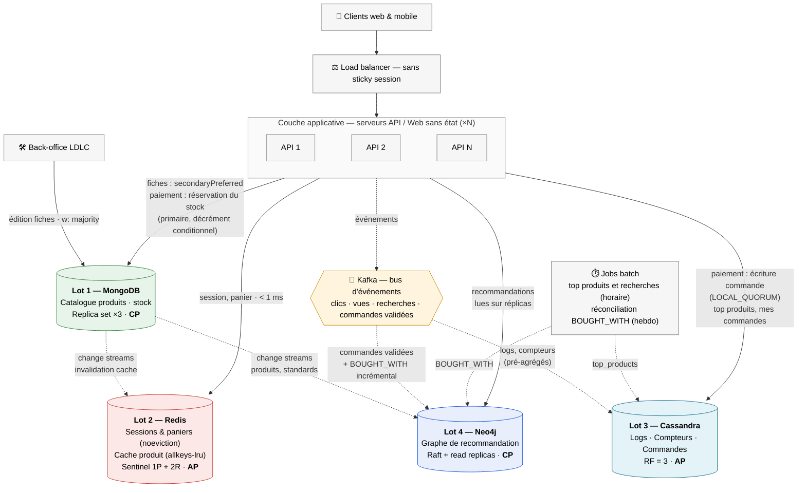

# Architecture globale — Refonte LDLC



> Le schéma ci-dessus est rendu directement par GitHub. Source éditable : [`architecture.mmd`](architecture.mmd).
> Export en image : `npx -p @mermaid-js/mermaid-cli mmdc -i architecture.mmd -o architecture.svg` (ou `-o architecture.png -w 2000 -b white`).

**Lecture du schéma :** les flèches pleines sont les **appels synchrones**, faits pendant la requête de l'utilisateur. Les flèches pointillées sont les **flux asynchrones** (événements, synchronisations, jobs), dont l'utilisateur n'attend jamais la fin.

---

## 1. Principe : la persistance polyglotte

Aucune base ne répond seule aux quatre besoins. Chaque lot est confié au modèle de données qui lui correspond :

| Lot | Base | Modèle | Pourquoi ce modèle | CAP | Cohérence choisie |
|---|---|---|---|---|---|
| 1. Catalogue | **MongoDB** | Document | Schémas variables, fiche lue en un seul document | **CP** | Lecture sur secondaires pour l'affichage ; primaire + `majority` pour le prix au paiement ; **décrément conditionnel du stock** |
| 2. Panier & sessions | **Redis** | Clé-valeur en mémoire | Latence sub-ms, TTL natif, partagé entre serveurs | **AP** (nuancé : la bascule Sentinel exige une majorité) | Réplication asynchrone : perte possible de quelques ms d'écritures en cas de panne |
| 3. Logs & analytics | **Cassandra** | Colonnes larges | Écritures massives, scalabilité linéaire, séries temporelles | **AP** | `LOCAL_ONE` pour les logs ; `LOCAL_QUORUM` pour les commandes |
| 4. Recommandations | **Neo4j** | Graphe | Parcours de relations sur plusieurs sauts | **CP** | Écritures validées par Raft ; recommandations lues sur les réplicas |

**Lecture CAP de l'ensemble :** on choisit **CP là où une erreur coûte de l'argent** (prix et stock dans le catalogue, intégrité du graphe), et **AP là où l'indisponibilité coûte plus cher qu'une incohérence passagère** (un panier qui ne répond pas, un clic non enregistré).

---

## 2. Les composants

| Composant | Rôle |
|---|---|
| **Load balancer** | Répartit le trafic entre les serveurs. Pas de *sticky session* : la session est dans Redis, donc n'importe quel serveur peut traiter n'importe quelle requête |
| **Serveurs API / Web** | **Sans état** : on en ajoute ou en retire selon la charge, par exemple lors de la sortie d'un nouveau GPU |
| **Kafka** | Bus d'événements. Il découple le site des écritures analytiques : un clic est déposé dans la file en moins d'1 ms, puis consommé à son rythme. Il absorbe les **pics** (la file grossit, puis se vide) et permet à **plusieurs consommateurs** (Cassandra, Neo4j) de lire le même événement. La **commande**, elle, n'attend pas Kafka : elle est écrite de façon synchrone dans Cassandra avant d'être confirmée au client |
| **Jobs batch** | Calculs différés : top produits et top recherches (toutes les heures, Cassandra) et réconciliation de `BOUGHT_WITH` (chaque semaine, Neo4j ; la relation est sinon mise à jour à chaque commande) |
| **Back-office** | Saisie et édition des fiches produits par les équipes LDLC, directement dans MongoDB |

---

## 3. Les flux

### Flux synchrones (pendant la requête de l'utilisateur)

| Action utilisateur | Bases sollicitées |
|---|---|
| Arrivée sur le site | Redis : lecture ou création de la session |
| Consultation d'une fiche produit | Redis (cache produit) → sinon MongoDB (secondaire) ; Neo4j pour le bloc « achetés ensemble » |
| Ajout au panier | Redis (`HINCRBY`) |
| Page « Tendances » | Cassandra (`top_products_by_period`) |
| Page « Mes commandes » | Cassandra (`orders_by_customer`) |
| Paiement | Redis (lecture du panier) → MongoDB **primaire** (revérification du prix, **réservation du stock** par décrément conditionnel en transaction) → paiement → Cassandra (**écriture synchrone** de la commande, `LOCAL_QUORUM`) → publication de l'événement « commande validée » → suppression du panier Redis |

### Flux asynchrones (synchronisation entre bases)

| Source | Destination | Contenu | Mécanisme |
|---|---|---|---|
| API | Kafka | Clics, vues, recherches, commandes validées | Publication d'événements |
| Kafka | Cassandra | Journal brut, compteurs (pré-agrégés par le consommateur) | Consommateur Kafka |
| Kafka | Neo4j | Nouvelles commandes (`Order`, `CONTAINS`) et incrément de `BOUGHT_WITH` | Consommateur Kafka (idempotent) |
| MongoDB | Neo4j | Nouveaux produits, standards techniques | **Change streams** |
| MongoDB | Redis | Invalidation du cache quand un prix change | **Change streams** |
| Jobs | Cassandra / Neo4j | Top produits et recherches ; réconciliation `BOUGHT_WITH` | Batch horaire / hebdomadaire |

---

## 4. Le parcours d'une commande à travers les 4 bases

```
1. Le client ajoute un Ryzen 7 au panier      → Redis      HINCRBY cart:user:42 AMD-R7-7800X3D 1
2. Il clique sur « Payer »                     → MongoDB    prix relu et stock réservé sur le primaire
                                                            (updateOne si stock.quantity >= qté, $inc négatif)
3. Le paiement est accepté                     → Cassandra  orders_by_customer, écriture SYNCHRONE (LOCAL_QUORUM)
4. La commande est confirmée au client         → Kafka      événement « order_placed » ; Redis : DEL du panier
5. Le consommateur Neo4j l'ajoute au graphe    → Neo4j      (Customer)-[:PLACED]->(Order)-[:CONTAINS]->(Product)
                                                            et BOUGHT_WITH.count + 1 pour chaque paire
6. Le client suivant qui regarde ce Ryzen 7    → Neo4j      « souvent acheté avec : ASUS TUF B650-Plus »
```

**En cas d'échec :** si le paiement est refusé, une écriture de compensation remet le stock dans MongoDB. Si l'écriture Cassandra échoue (timeout), l'API la rejoue : la clé primaire de la commande est identique, l'`INSERT` est donc idempotent.

---

## 5. Compromis globaux

| Compromis | Justification |
|---|---|
| **4 technologies à opérer** (compétences, supervision, sauvegardes) | Une base unique imposerait un compromis sur chaque besoin. LDLC a la taille d'équipe pour opérer cet ensemble, et chaque base peut être un service managé (MongoDB Atlas, Redis Cloud, Astra DB, Neo4j Aura) |
| **Données dupliquées** entre bases (sku, nom, prix dans MongoDB, Neo4j, Cassandra) | Chaque base doit répondre seule, sans jointure inter-bases. MongoDB reste la **source de vérité** du catalogue, et les copies sont alimentées par événements |
| **Cohérence éventuelle entre bases** (un nouveau produit apparaît dans Neo4j quelques secondes après MongoDB) | Sans impact métier : les données critiques sont traitées à la source et de façon synchrone au paiement (prix relu et stock réservé dans MongoDB, commande écrite en `LOCAL_QUORUM` dans Cassandra) |
| **Pas de transaction entre MongoDB et Cassandra** | Le paiement suit un enchaînement ordonné avec compensation (stock remis si le paiement échoue) et des écritures idempotentes, plutôt qu'une transaction distribuée coûteuse et fragile |
| **Kafka ajoute un composant** | Sans lui, chaque clic écrirait directement dans Cassandra pendant la requête, et un ralentissement de Cassandra ralentirait le site |
